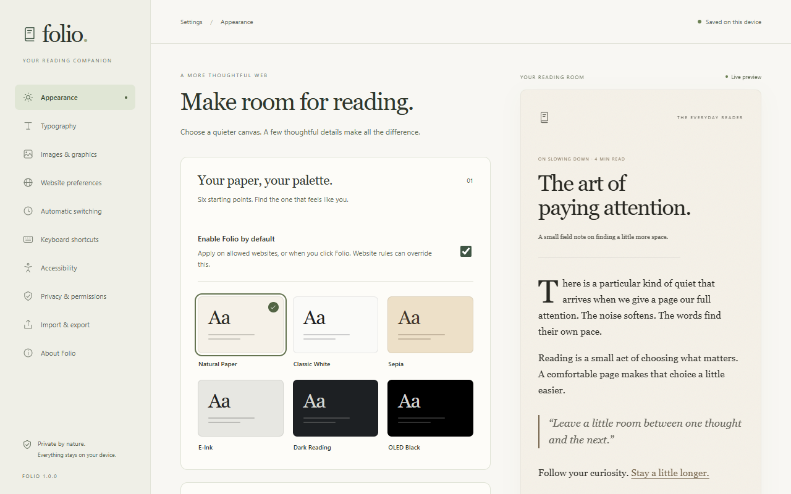
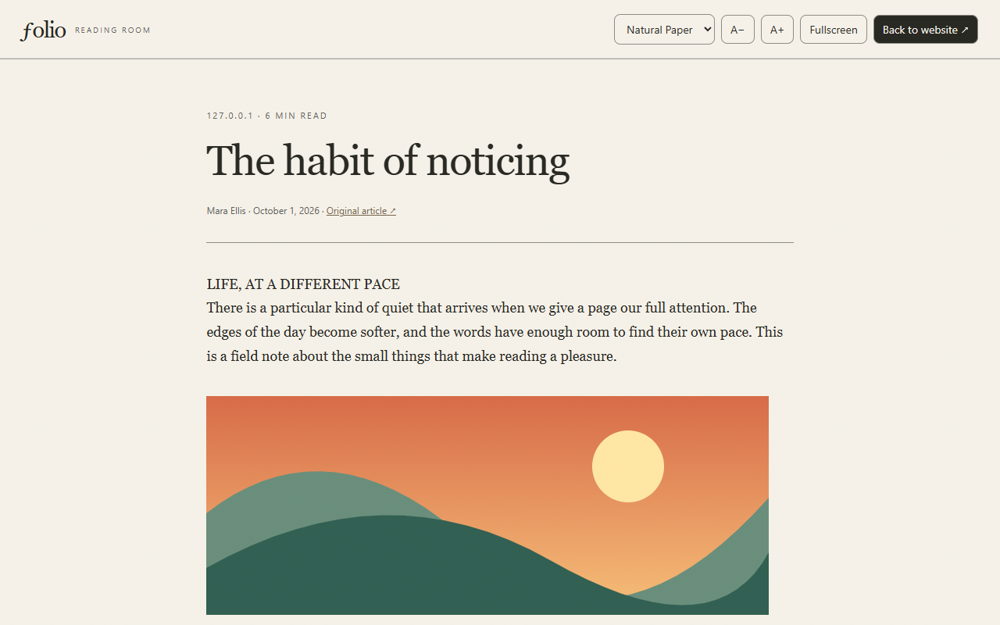

  

# Folio

**A calmer way to read the web.**

Folio is a Chrome extension that turns busy webpages into comfortable reading spaces. Choose a paper-inspired palette, soften harsh colors, or open an article in a quiet reading room with typography that suits you.

Your preferences stay on your device. No accounts, subscriptions, analytics, or content uploads.

## Install Folio

Folio is currently available as a locally installed extension. It is not yet listed in the Chrome Web Store.

1. [Download Folio](https://github.com/0xAldoLim/Folio/archive/refs/heads/main.zip) and extract the ZIP.
2. Keep the extracted folder somewhere permanent. Chrome loads the extension from this folder.
3. Open `chrome://extensions` in Chrome 120 or later.
4. Turn on **Developer mode**, then select **Load unpacked**.
5. Choose the **`dist` folder inside Folio**, which contains the compiled extension and its `manifest.json`.
6. Pin Folio from Chrome's extensions menu, open a webpage, and click its icon.

The ready-to-use extension is included in `dist/`. You do not need Node.js or build tools to install it this way.

## Start reading

Click Folio on a webpage to apply your reading preferences. Pick a palette, adjust contrast or warmth, and use **Open Reader Mode** when you want the article on its own.

Your palette choice and Reader text size are remembered for that website. Contrast and warmth are shared across your reading preferences. Open **Settings** for more control over fonts, spacing, column width, images, and automatic theme switching.

Want Folio to work automatically when you return? Choose **Always use Folio on this site** and accept Chrome's site-access prompt. You can allow individual sites or choose broader access in settings.

## Choose your paper

| Palette | Feel |
| --- | --- |
| **Natural Paper** | Warm off-white with soft, dark ink. The default. |
| **Classic White** | A clean, neutral page with a cool accent. |
| **Sepia** | A warmer, book-inspired background. |
| **E-Ink** | A restrained monochrome palette inspired by e-readers. |
| **Dark Reading** | A dark gray page with gentle, light text. |
| **OLED Black** | A black background with muted light text. |

Switch palettes without reloading the page. Create custom palettes in Settings, or fine-tune text contrast, background luminance, warmth, and accent saturation. Contrast protection keeps extension-controlled reading colors readable as you adjust them.

E-Ink is a visual palette; it cannot reproduce reflective display hardware.

## A reading room for your articles

Reader Mode puts the article in a separate reading surface while keeping the original webpage open underneath.

- Choose a font, text size, line height, letter spacing, paragraph spacing, alignment, and reading width.
- Keep article images, tables, code blocks, quotations, and links in the reading view.
- See the source, available author and date, estimated reading time, and reading progress.
- Add subtle paper grain or optional image dimming.
- Read in fullscreen, then return to the website without reloading it.

Press **Escape** or **Back to website** to leave. Folio remembers your reading position for the current article while the page stays open.

Reader Mode works best on individual articles and documentation pages. If Folio cannot confidently identify the article, it explains the limitation and leaves the original page intact.

## Keep control of each website

Use the popup switch to temporarily turn Folio on or off for the current tab.

| Control | What it does |
| --- | --- |
| **Disable for this site** | Keeps Folio off for that website until you change its rule. |
| **Reset site** | Removes the website's preferences and temporary override, returning to global behavior. |
| **Restore original website** | The circular restore button immediately removes Folio's styling and closes Reader Mode for the current tab. |
| **Website preferences** | Sets a site's palette, enabled state, Reader typography, image brightness exception, and article availability hint. |

Website preferences match the exact address origin: HTTP and HTTPS, different subdomains, and non-default ports can have separate rules. Temporary overrides are scoped to the tab and origin, and disappear when the tab closes or Chrome restarts.

Photographs keep their colors by default. Image dimming is optional, and you can preserve original brightness on image-heavy sites. Regular website mode keeps existing fonts, spacing, and layout; the fuller typography controls apply in Reader Mode.

## Follow the light

Keep your selected palette, follow your system's light/dark appearance, or schedule separate day and night palettes using your device's local time.

When settings overlap, Folio uses this order:

1. A temporary override for the current tab.
2. A preference for the website.
3. System appearance or your day/night schedule.
4. Your global default palette.

## Keyboard shortcuts

| Action | Default shortcut |
| --- | --- |
| Turn Folio on or off | `Alt + Shift + F` |
| Cycle palettes | `Alt + Shift + L` |
| Enter or exit Reader Mode | `Alt + Shift + R` |
| Leave Reader Mode | `Escape` |

Change the browser shortcuts at `chrome://extensions/shortcuts`. If another shortcut conflicts, assign a different combination there.

## Your reading stays yours

Folio processes webpages locally and stores settings on your device. It does not upload articles, record your browsing history, or use remote scripts, advertising, or analytics.

Chrome's permissions let Folio work when you click it, save your preferences, and switch themes on schedule. Persistent website access is optional and enables automatic operation on sites you approve. Review or revoke it in **Settings → Privacy & permissions** or Chrome's extension settings.

Reader images may still load from their original sources with referrer information suppressed. Settings exports include the website origins you chose, so keep backups private if those addresses are sensitive.

Read the [privacy notice](PRIVACY.md) for the details.

## If something does not look right

- **No change after navigation?** Click Folio again, or enable **Always use Folio on this site** for automatic operation.
- **A site looks wrong?** Use **Restore original website** or **Disable for this site**. Another dark-mode extension or unusually strong website styles may conflict.
- **Reader Mode cannot find an article?** Open the full story rather than a feed, search page, or app screen. Folio cannot supply content behind a paywall or content that has not loaded.
- **Chrome will not let Folio change a page?** Browser settings, the Chrome Web Store, extension pages, local files, and the native PDF viewer are unavailable. Embedded frames, shadow-tree content, and canvas graphics may retain their original appearance.
- **Updated Folio?** Replace the extension files, click **Reload** on its card at `chrome://extensions`, and reload any open webpages to refresh their content scripts.

Compatibility varies by website. Folio has automated checks on controlled fixtures; those do not establish compatibility with every publisher or web app.

## Help and project details

Found a problem? [Open an issue](https://github.com/0xAldoLim/Folio/issues) with your Chrome version, the affected website, and steps to reproduce it. Avoid including private article content or personal form data.

- [Build and development guide](DEVELOPMENT.md)
- [Testing report and known limits](TESTING.md)
- [Architecture](ARCHITECTURE.md)
- [Third-party notices](THIRD_PARTY_NOTICES.md)

Folio is available under the [MIT license](LICENSE).
